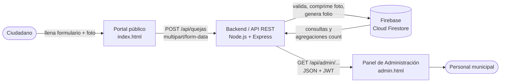

# Sistema de Atención de Quejas Ciudadanas

Sistema web funcional para que la ciudadanía registre quejas o reportes (con fotografía) ante la Municipalidad, y para que el personal municipal los revise y les dé seguimiento desde un panel de administración.

| | |
|---|---|
| **Sitio publicado** | <https://quejas-ciudadanas-5wxj.onrender.com> |
| **Panel de administración** | <https://quejas-ciudadanas-5wxj.onrender.com/admin> |
| **Repositorio** | <https://github.com/00AbiMendoza/quejas-ciudadanas> |

**Tecnologías:** HTML5, CSS3 y JavaScript (frontend) · Node.js + Express (backend/API REST) · **Firebase Cloud Firestore en plan gratuito Spark** (persistencia) · Sharp (procesamiento de imágenes) · JWT (sesión del panel).

---

## 1. Cumplimiento del enunciado

### Serie I · Análisis, diseño y frontend

| Requisito | Implementación |
|---|---|
| **A. Portal público:** ingresar queja | Formulario por secciones: categoría, asunto, descripción, dirección, zona, referencia, ubicación GPS opcional y datos de contacto (o reporte anónimo). |
| Adjuntar fotografía | Arrastrar/soltar o elegir archivo, con vista previa, validación de formato (JPG/PNG/WEBP) y tamaño (máx. 5 MB). |
| Enviar la información | Se envía a la API como `multipart/form-data`, con barra de progreso de subida. |
| Recibir confirmación | Pantalla de confirmación con **folio único** (p. ej. `QC-2026-7KX3PM`), resumen y botón para copiarlo. |
| Extras | Validación en vivo con mensajes por campo, resumen de errores accesible, consulta pública del estado por folio con línea de tiempo, diseño responsivo. |
| **B. Panel municipal:** visualizar quejas | Bandeja paginada con folio, fecha, asunto, extracto, categoría, ubicación, miniatura de la foto, prioridad y estado. |
| Consultar descripción original | Cajón de detalle que muestra el texto **tal como lo escribió el ciudadano** (respetando saltos de línea). |
| Visualizar fotografía | Foto en el detalle, ampliable a pantalla completa. Miniaturas en el listado. |
| Información organizada | Indicadores por estado (clic = filtrar), gráfico por categoría, actividad reciente, búsqueda sin importar tildes, filtros (estado, categoría, prioridad, foto, rango de fechas), orden y paginación. |
| Extras | Inicio de sesión, cambio de estado/prioridad con comentario, historial de cambios, aviso automático de quejas nuevas. |
| **Condición:** pantallas integradas, sin datos simulados | Ningún dato está escrito en el código: hasta las categorías y estados se obtienen de `GET /api/catalogos`. Si la base está vacía, el panel lo indica. |

### Serie II · Backend, API y Firebase

| Requisito | Implementación |
|---|---|
| Recibir la información del frontend | `POST /api/quejas` (Express + Multer). |
| Procesar solicitudes en el backend | Validación y limpieza de cada campo, verificación real de la imagen, compresión, generación de folio. |
| Registrar en **Firebase capa gratuita** | Cloud Firestore (plan Spark) mediante Firebase Admin SDK. Escritura atómica (batch) de la queja y su foto. |
| Consultar reportes almacenados | `GET /api/admin/quejas`, `GET /api/admin/quejas/:folio`, `GET /api/quejas/seguimiento/:folio`. |
| Recuperar información desde el panel | El panel consume la API con un token JWT. |
| Validaciones y errores | Validación en frontend **y** backend, errores por campo, códigos HTTP correctos, mensajes en español, manejo centralizado (Firestore caído, archivo muy grande, JSON inválido, sesión expirada, etc.). |
| Comunicación frontend ↔ backend | API REST JSON con formato uniforme `{ ok, datos }` / `{ ok:false, error:{ codigo, mensaje, detalles } }`. |

### Flujo mínimo demostrado



Este flujo está cubierto por **17 pruebas automatizadas** (`backend/tests/flujo.test.js`) que registran una queja real con foto, la leen desde Firestore y la consultan como administrador.

---

## 2. Arquitectura y estructura

```
quejas-ciudadanas/
├── frontend/                     ← Serie I (servido por el mismo backend)
│   ├── index.html                Pantalla A · Portal público
│   ├── admin.html                Pantalla B · Panel de Administración
│   ├── 404.html
│   └── assets/
│       ├── css/  base.css · portal.css · admin.css
│       ├── js/   api.js (cliente de la API) · utils.js · portal.js · admin.js
│       └── img/  favicon.svg
├── backend/                      ← Serie II
│   ├── src/
│   │   ├── server.js             Arranque y verificación de Firestore
│   │   ├── app.js                Express: seguridad, CORS, rutas, estáticos
│   │   ├── config/               env.js (variables) · firebase.js (Admin SDK)
│   │   ├── constants/            catalogos.js (categorías, estados, prioridades)
│   │   ├── routes/               index.js (definición de la API)
│   │   ├── controllers/          publico · admin · auth
│   │   ├── services/             quejas (Firestore) · imagen (Sharp) · auth (JWT)
│   │   ├── validators/           queja.validator.js
│   │   ├── middlewares/          autenticación · subida de foto · límites · errores
│   │   └── utils/                ApiError · texto
│   ├── tests/flujo.test.js       Prueba de integración del flujo completo
│   └── .env.example
├── firebase.json · firestore.rules
├── render.yaml                   Despliegue en Render (plan gratuito)
└── package.json                  Scripts de la raíz (instalar, iniciar, probar)
```

Arquitectura en capas: **rutas → controladores → validadores → servicios → Firestore**. El navegador **nunca** se conecta directamente a Firebase ni recibe credenciales; las reglas de Firestore (`firestore.rules`) bloquean todo acceso directo de clientes.

### Modelo de datos (Cloud Firestore)

**Colección `quejas`** — ID del documento = folio

```jsonc
{
  "folio": "QC-2026-7KX3PM",
  "categoria": "calles",
  "asunto": "Bache profundo frente a la escuela",
  "descripcion": "Texto original del ciudadano…",
  "ubicacion": {
    "direccion": "4a. calle 8-15", "zona": "Zona 3", "referencia": "Frente a la escuela",
    "coordenadas": { "latitud": 14.6349, "longitud": -90.5069 }   // o null
  },
  "ciudadano": { "anonimo": false, "nombre": "José Pérez", "correo": "jose@correo.com", "telefono": "41235678" },
  "estado": "recibida",          // recibida | en_revision | en_proceso | resuelta | rechazada
  "prioridad": "media",          // baja | media | alta
  "tieneFoto": true,
  "foto": { "mime": "image/jpeg", "ancho": 1600, "alto": 1067, "bytes": 245810 },
  "historial": [
    { "tipo": "estado", "estado": "recibida", "estadoAnterior": null,
      "comentario": "Queja registrada desde el portal ciudadano.", "usuario": "Sistema", "fecha": "<Timestamp>" }
  ],
  "fechaCreacion": "<Timestamp>",
  "fechaActualizacion": "<Timestamp>",
  "origen": { "canal": "portal_web", "agente": "Mozilla/5.0 …" }
}
```

**Colección `quejas_fotos`** — mismo ID (folio). Guarda la imagen comprimida (`imagen`, tipo Bytes) y una miniatura WEBP (`miniatura`). Se separa para que el listado del panel no descargue imágenes.

> **¿Por qué la foto se guarda en Firestore y no en Cloud Storage?** Firebase ahora exige el plan **Blaze** (de pago) para usar Cloud Storage, y el enunciado pide la **capa gratuita**. Firestore sí está en el plan Spark, pero limita cada documento a 1 MiB. Por eso el backend endereza la foto, elimina sus metadatos (incluida la ubicación GPS de la cámara), la redimensiona a máx. 1600 px y la comprime a JPEG por debajo de ~750 KB antes de guardarla.

---

## 3. API REST

Base: `/api`. Todas las respuestas son JSON (excepto la foto).

| Método | Ruta | Acceso | Descripción |
|---|---|---|---|
| GET | `/salud` | Público | Estado de la API y conexión con Firestore |
| GET | `/catalogos` | Público | Categorías, estados, prioridades y límites de campos |
| POST | `/quejas` | Público | Registra una queja (`multipart/form-data`, campo `foto` opcional) |
| GET | `/quejas/seguimiento/:folio` | Público | Estado e historial público (sin datos personales) |
| POST | `/auth/login` | Público | `{ usuario, password }` → `{ token, expira, usuario }` |
| GET | `/auth/sesion` | JWT | Verifica el token |
| GET | `/admin/estadisticas` | JWT | Totales por estado y categoría, últimas 24 h y 7 días |
| GET | `/admin/quejas` | JWT | Listado con `q, estado, categoria, prioridad, conFoto, desde, hasta, orden, pagina, limite` |
| GET | `/admin/quejas/:folio` | JWT | Detalle completo |
| GET | `/admin/quejas/:folio/foto` | JWT | Imagen (`?tamano=miniatura` para la miniatura) |
| PATCH | `/admin/quejas/:folio` | JWT | `{ estado?, prioridad?, comentario? }` |

**Ejemplo de respuesta exitosa** (`POST /api/quejas` → `201 Created`):

```json
{
  "ok": true,
  "mensaje": "Tu queja fue registrada correctamente.",
  "datos": { "id": "QC-2026-7KX3PM", "folio": "QC-2026-7KX3PM", "estado": "recibida",
             "categoria": "calles", "asunto": "Bache profundo…", "tieneFoto": true,
             "fechaCreacion": "2026-11-14T15:33:10.512Z" }
}
```

**Ejemplo de error de validación** (`400 Bad Request`):

```json
{
  "ok": false,
  "error": {
    "codigo": "VALIDACION",
    "mensaje": "Revisa los datos ingresados: hay campos con errores.",
    "detalles": [
      { "campo": "descripcion", "mensaje": "La descripción debe tener al menos 20 caracteres." },
      { "campo": "correo", "mensaje": "Ingresa un correo electrónico válido (ejemplo: nombre@correo.com)." }
    ]
  }
}
```

Códigos usados: `200`, `201`, `400` (validación), `401` (sin sesión / credenciales), `404`, `413` (foto muy grande), `429` (demasiadas solicitudes), `500`, `503` (Firestore no disponible).

### Validaciones principales

| Campo | Regla |
|---|---|
| Categoría | Obligatoria y debe existir en el catálogo |
| Asunto | 5–100 caracteres |
| Descripción | 20–2000 caracteres (se conservan los saltos de línea) |
| Dirección | 5–200 caracteres |
| Nombre | Obligatorio si no es anónimo; solo letras |
| Contacto | Si no es anónimo: correo **o** teléfono; correo con formato válido; teléfono de 8–15 dígitos |
| Fotografía | Opcional; JPG/PNG/WEBP; máx. 5 MB; se verifica que realmente sea una imagen (no solo la extensión) |
| GPS | Latitud −90…90 y longitud −180…180, ambas o ninguna |
| Consentimiento | Obligatorio |
| Cambio de estado | "Resuelta" y "No procede" exigen un comentario para el ciudadano |

### Seguridad

- Credenciales de Firebase solo en el servidor; reglas de Firestore que niegan todo acceso desde clientes.
- Panel protegido con JWT (expira en 8 h); comparación de contraseña en tiempo constante.
- Límite de solicitudes por IP: 10 quejas / 15 min y 10 intentos de login / 10 min.
- Encabezados de seguridad y política CSP con Helmet; todo texto se escapa antes de mostrarse (previene XSS).
- Campo trampa (honeypot) contra bots; límite de tamaño de archivos y de cuerpo JSON.
- Los folios son aleatorios (no secuenciales), por lo que no se pueden adivinar; la consulta pública no expone datos personales.

---

## 4. Ejecutar en tu computadora

**Requisitos:** Node.js 20 o superior y una cuenta de Google.

### 4.1 Configurar Firebase (plan gratuito Spark)

1. Entra a <https://console.firebase.google.com> → **Crear un proyecto** (por ejemplo `quejas-ciudadanas`). Google Analytics es opcional. El proyecto queda en el plan **Spark (gratuito)**; no hace falta tarjeta.
2. En el menú **Compilación → Firestore Database** → **Crear base de datos**.
   - Si pregunta la edición, elige **Standard**. Deja el ID `(default)`.
   - Ubicación: `nam5 (United States)` o la más cercana.
   - Modo: **producción**.
3. En la pestaña **Reglas**, pega el contenido de [`firestore.rules`](firestore.rules) y presiona **Publicar**.
4. Ve a ⚙ **Configuración del proyecto → Cuentas de servicio → Generar nueva clave privada**. Se descarga un archivo `.json`.
5. Renómbralo a `serviceAccountKey.json` y colócalo dentro de la carpeta `backend/`. **No lo subas a GitHub** (ya está en `.gitignore`).

### 4.2 Instalar e iniciar

```bash
npm install
```

```bash
cp backend/.env.example backend/.env
```

Edita `backend/.env`: cambia `ADMIN_PASSWORD` y `JWT_SECRET` (puedes generar uno con `node -e "console.log(require('crypto').randomBytes(32).toString('hex'))"`).

```bash
npm start
```

- Portal ciudadano: <http://localhost:3000>
- Panel de administración: <http://localhost:3000/admin> (usuario y contraseña de `.env`)

Al iniciar, la consola indica si la conexión con Firestore fue exitosa.

### 4.3 Pruebas automatizadas (con el emulador de Firestore)

Las pruebas usan el **emulador local** de Firebase para no tocar la base de datos real. El emulador necesita Java (con Java 11–17 usa `firebase-tools@13`; con Java 21+ funciona la versión más reciente).

Terminal 1 (en la raíz del proyecto):

```bash
npm run emulador
```

Terminal 2:

```bash
npm test
```

---

## 5. Publicar (entrega: link publicado + link de GitHub)

### 5.1 Subir a GitHub

```bash
git init
```

```bash
git add . && git commit -m "Sistema de atención de quejas ciudadanas"
```

```bash
gh repo create quejas-ciudadanas --public --source . --push
```

(O crea el repositorio en github.com y usa `git remote add origin …` + `git push -u origin main`.) Verifica que **no** aparezcan `backend/.env` ni `serviceAccountKey.json` en el repositorio.

### 5.2 Publicar en Render (gratis)

1. Entra a <https://render.com> e inicia sesión con tu cuenta de GitHub.
2. **New → Blueprint** → elige el repositorio. Render leerá [`render.yaml`](render.yaml).
3. Te pedirá dos valores:
   - `FIREBASE_SERVICE_ACCOUNT_JSON`: abre `serviceAccountKey.json` con el Bloc de notas, copia **todo** su contenido y pégalo.
   - `ADMIN_PASSWORD`: la contraseña del panel.
4. **Apply**. En 2–4 minutos tendrás una URL como `https://quejas-ciudadanas-xxxx.onrender.com` → ese es el **link publicado**. El panel está en `/admin`.

*Alternativa manual:* **New → Web Service** → repositorio → Build command `npm install` · Start command `npm start` · agrega las variables de `render.yaml`.

> **Nota del plan gratuito de Render:** el servicio se "duerme" tras 15 minutos sin visitas y la primera carga tarda ~1 minuto en despertar. Abre el enlace un momento antes de presentarlo.

---

## 6. Decisiones de diseño y limitaciones

- **Backend propio en lugar de escribir a Firebase desde el navegador:** cumple con el flujo exigido (Frontend → Backend/API → Firebase), permite validar todo en el servidor y mantiene las credenciales fuera del navegador.
- **Filtros:** los filtros por igualdad (estado, categoría, prioridad) se resuelven en Firestore; la búsqueda de texto, el rango de fechas y la paginación se aplican en el backend porque Firestore no tiene búsqueda de texto completo. Es adecuado para el volumen de una municipalidad pequeña o una demostración; para miles de registros se usarían índices compuestos con paginación por cursor y un motor de búsqueda (p. ej. Algolia o Typesense).
- **Indicadores:** se calculan con consultas de agregación `count()` de Firestore, sin descargar los documentos.
- **Cuotas gratuitas de Firestore (Spark):** 50 000 lecturas y 20 000 escrituras por día, y 1 GiB de almacenamiento; suficiente para el proyecto.
- **Usuario del panel:** un solo administrador definido por variables de entorno. Como mejora se podría usar Firebase Authentication con varios usuarios y roles.
